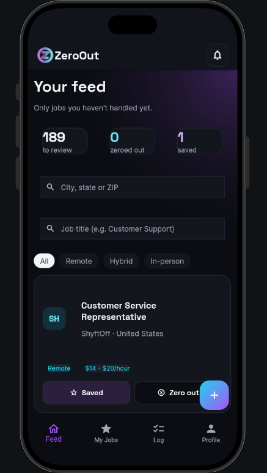
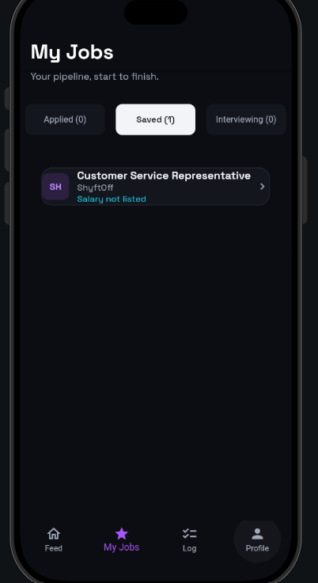
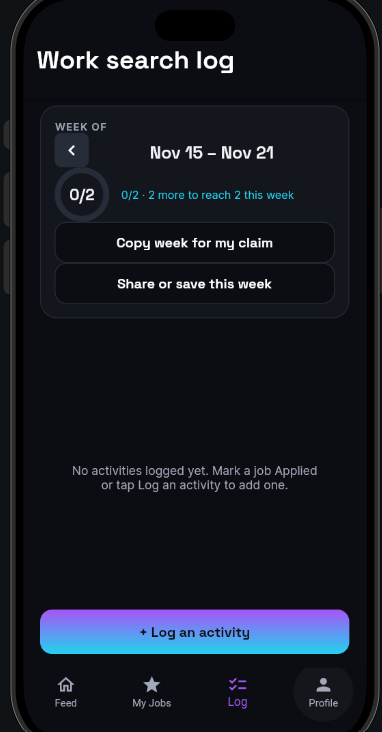
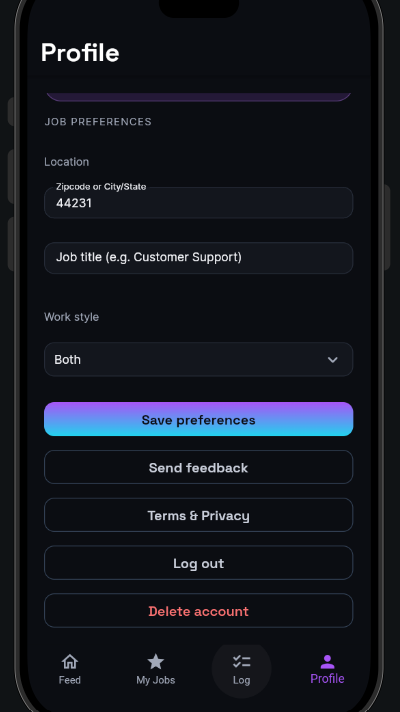

# ZeroOut: Every job board. None of the clutter.

**ZeroOut** is a mobile job search app I designed and built, from the first idea to a working product with payments and a beta waitlist.

> Status: private beta starting January 2027. Source code is private; this page shows the product and how it was built.

---

## The problem

During my own job search I had a dozen job-board tabs open every day. The same postings showed up on five different sites. Jobs I had already rejected kept coming back. And because I was on unemployment, I also had to keep a separate log of every application for my weekly claim.

Job seekers don't need *more* listings. They need fewer, better ones, and a way to keep track.

## What ZeroOut does

| Feature | What it means for the user |
|---|---|
| **One feed, many job boards** | Jobs from several public job sources and company career pages in one place |
| **Duplicates removed** | The same job posted on multiple boards shows up once |
| **Zero Out** | Dismiss a job once and it never comes back |
| **A feed that learns** | Saving, applying to, or zeroing out jobs re-ranks the feed toward what you actually want |
| **Location and title search** | Search by city, state, or ZIP; in-person jobs stay local, remote jobs stay in the US |
| **My Jobs tracker** | Saved, Applied, and Interviewing in one place |
| **Work-search log** | Jobs marked Applied are logged automatically; copy or share your week for an unemployment claim |
| **In-app feedback** | Testers send notes straight from the app |

| Feed | My Jobs | Work-search log | Profile |
|---|---|---|---|
|  |  |  |  |

## How it's built

- **App:** FlutterFlow (Flutter), with iOS, Android, and web targets
- **Backend:** Supabase: Postgres database with row-level security on every table, authentication, and edge functions
- **Job search service:** a Supabase edge function that queries multiple free job sources in parallel, normalizes the results, removes duplicates, filters by location, and ranks them for each user
- **Speed:** popular searches are pre-loaded on a schedule and cached, so the feed opens fast
- **Payments:** Stripe Checkout for a planned Pro subscription, with signed webhooks that update the user's plan
- **Privacy:** users can only see their own data, and can delete their account from the app

## My role

I'm the founder and product owner. I:

- Defined the product from my own experience as a job seeker and 20+ years in customer support
- Made the product decisions: what's free, what's Pro, and what waits until after beta
- Built the app in FlutterFlow and configured Supabase and Stripe, working with AI coding assistants for the heavy lifting
- Ran QA: wrote test plans, reproduced bugs, and traced problems from the screen down to the server
- Planned the beta: tester offer, feedback loop, and launch checklist

## A bug I'm proud of finding

Testers searched for jobs near Akron, Ohio and still saw in-person jobs in Texas and Washington. The job search itself worked when tested directly, so I traced the app's requests in the server logs: every search was being sent with a **blank location**, even though the user's text showed in the box. Fixing how the app passed the location value solved it, and the same test then returned only local and remote jobs.

It's the kind of problem support teams see every day: the screen says one thing, the system does another. Finding where they disagree is the job.

## What's next

- January 2027: private beta with former coworkers and friends
- AI resume tailoring and cover letters (Pro)
- Daily job alerts and follow-up reminders

---

Built by Chrissy Snyder · [LinkedIn](https://www.linkedin.com/in/chrissysnyder002)
